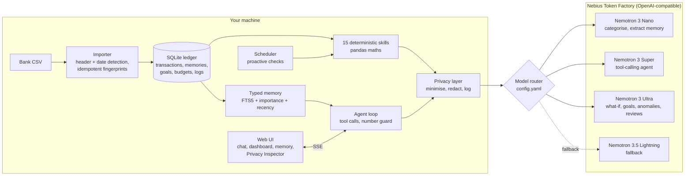

# Ledgermind

**A private AI finance assistant that remembers your money.** Built on **NVIDIA Nemotron** models served by
**Nebius Token Factory** for the Nebius x NVIDIA Global AI Hackathon, **Personal AI** track.

[](LICENSE)


- **Video (3 min):** https://youtu.be/VGxJTs_w71s
- **Try it:** runs offline with no key, see [Quick start](#quick-start)
- **Measured on live Nemotron:** 19 of 19 finance questions fully correct after fixing what the earlier runs
  found (13/19, then 16/19), with every answer's figures verified by the number guard; categorisation 92-96% with rules + model; memory extraction F1 0.84 (Nano) to 0.91 (Super).
  See [Results](#results).


Import a bank statement as CSV and talk to your money: *"Where did my money go last month?"*,
*"I'm saving ₹3 lakh for a Japan trip by March"*, *"What if I cut dining by 30%?"*. Ledgermind remembers your goals,
budgets, habits and corrections between conversations, notices things before you ask (a duplicate charge, a price
rise, a budget about to break), and it never makes up a number: every figure is computed in Python from your own
ledger, and the model only explains it.

> Ledgermind gives informational insights, not financial advice. It makes no investment recommendations or
> guarantees.

## What it does

| | |
|---|---|
| **Remembers you** | Typed memories (profile, goal, habit, recurring, preference, correction, decision). Nemotron Nano extracts them after each turn, near-duplicates are merged, and retrieval blends full-text relevance, importance and recency. Every memory is visible and editable: pin, edit, delete, or "forget" in chat. |
| **Does the maths in code** | 15 deterministic skills: spending summaries, subscription detection (price rises, forgotten overlaps), anomaly detection (duplicates, unusual amounts, large one-offs, category spikes), budgets with month-end projection, savings goals, a what-if simulator, monthly reviews, categorisation and corrections, remember/forget. A number guard checks that every figure in an answer appears in a tool result, memory or your message, and regenerates the answer once if not. |
| **Keeps your data** | CSV import only, by design: no bank logins, nothing that can move money. Transaction rows, account numbers and raw bank descriptions stay in a local SQLite file. Text is redacted (emails, UPI IDs, card, account, Aadhaar, PAN, IFSC, phone numbers, names of people you pay) before any call, and the Privacy Inspector shows exactly what was sent. Strict mode sends only totals and counts. Export or wipe everything in one click. |
| **Notices things** | A background scheduler (APScheduler) checks for new subscriptions, price rises, possibly forgotten subscriptions, budgets at risk, duplicate or unusual charges, and writes a weekly digest. They appear as "Ledgermind noticed…" cards, with **Run checks now** for demos. |
| **Uses the right model** | A config-driven router sends bulk work to Nemotron 3 Nano, the tool-calling conversation to Nemotron 3 Super and deep reasoning to Nemotron 3 Ultra, with retries, timeouts, fallback chains and a cost and latency log. Each answer shows which model wrote it and how long it took. |
| **Explains a month** | A monthly review (figures computed locally, narrative by Nemotron Ultra, checked by the number guard) with wins, risks and exactly three actions, downloadable as Markdown or printable to PDF. |

<p>


</p>

## Architecture



One user turn (`ledgermind/agent/loop.py`):

1. Retrieve the most relevant memories and build the system prompt (today, ledger coverage, memories, rules).
2. Nemotron 3 Super chooses and chains tools (up to `agent.max_iterations` rounds, then a forced answer). Malformed
   tool arguments are repaired or re-requested once; unknown tools and failing skills come back as errors the model
   can recover from.
3. Each tool result is minimised (identifiers and raw descriptions dropped, rows capped, money pre-formatted as
   strings so the model copies rather than computes) and redacted before it is sent. The UI sees both what the
   model saw and the full local result.
4. After a deep tool (what-if, goal progress, anomalies) the rest of the turn moves to Nemotron 3 Ultra.
5. The answer streams to the browser. The number guard checks it; one regeneration, then any unverified figure is
   flagged in the reply.
6. Nemotron 3 Nano extracts new memories from the exchange (skipped when an explicit memory tool already ran).

## How Ledgermind uses NVIDIA Nemotron

| Role | Model (Token Factory ID) | Used for | Why this model |
|---|---|---|---|
| `fast` | Nemotron 3 Nano (`nvidia/NVIDIA-Nemotron-3-Nano-30B-A3B`) | Categorising unknown merchants in batches (JSON), extracting memories after every turn, consolidating long memory lists | High-volume background work where latency and price matter most; thinking is switched off for these calls |
| `agent` | Nemotron 3 Super (`nvidia/nemotron-3-super-120b-a12b`) | The conversation: function calling over 15 tools, multi-step chains, everyday answers | Reliable tool selection and instruction following at a mid-tier price |
| `deep` | Nemotron 3 Ultra (`nvidia/Nemotron-3-Ultra-550b-a55b`) | What-if narration, goal plans, anomaly explanations, monthly reviews | The few answers that need real reasoning; thinking is on and the reasoning trace is stripped before display |
| fallback | Nemotron 3.5 Lightning (`nvidia/Nemotron-3_5-Lightning`) | Second link in every chain | Function calling at Nano's price, so the app degrades gracefully if a model is unavailable |

Chains live in [`config.yaml`](config.yaml) (`fast: [nano, lightning]`, `agent: [super, lightning, nano]`,
`deep: [ultra, super, lightning]`), and any model ID can be overridden with `LEDGERMIND_MODEL_<ALIAS>`.
`make check` lists the Nemotron models your key can reach and pings each configured one.

### Where Token Factory helped

- **One endpoint, many models.** Every Nemotron size sits behind the same OpenAI-compatible API, so the router is a
  list of model names and the stock `openai` SDK works unchanged. Moving a task between Nano, Super and Ultra is a
  one-line config change, which is what made per-task routing cheap to build and to tune.
- **Native function calling and JSON mode.** `tools` with `tool_choice` drive the agent loop, and
  `response_format` keeps categorisation and memory extraction parseable.
- **Streaming with usage.** SSE streaming (with `stream_options.include_usage`) gives token-by-token answers in the
  UI and exact token counts for the per-call cost log.
- **Predictable limits.** `Retry-After` on 429s made the router's backoff straightforward.
- **Pricing that rewards routing.** Input prices from 0.06 USD (Nano) to 1.00 USD (Ultra) per million tokens make
  "smallest model that does the job" a real saving; the Models tab shows the spend per model.

Doc findings, including where the docs and the brief disagreed, are in [docs/nebius_notes.md](docs/nebius_notes.md);
friction is logged in [FEEDBACK.md](FEEDBACK.md).

## Results

### Eval

[`eval/questions.yaml`](eval/questions.yaml) holds 19 finance questions over the seeded demo ledger (spending,
income, merchants, subscriptions, price rises, anomalies, goals, what-if, budgets, monthly review, memory and
corrections). [`eval/run_eval.py`](eval/run_eval.py) checks, for each one, that the right tools ran, that the tool
figures match values computed independently with pandas, that the answer carries those figures (within 1%) and
that the number guard verified it.

| Run | Pass rate | Notes |
|---|---|---|
| Offline mock models | **19 / 19** | Checks routing, maths, privacy and the guard end to end; the mock is scripted, so this is not a model score |
| Live Nemotron, first run (2026-10-14) | **13 / 19** | Super reused figures from earlier turns and once skipped the `remember` tool. The eval now starts each question fresh and the prompt was tightened |
| Live Nemotron, second run (2026-10-14) | **16 / 19** | Median 5.42 s per question. Tool maths matched pandas on 18 of 19; the number guard verified all 19 answers |
| Live Nemotron, third run, after the fixes below (2026-10-14) | **19 / 19** | Median 5.15 s per question. Tools, maths, answer figures and the number guard all correct on every question. Full table: [eval/results.md](eval/results.md) |

The three live failures in the second run, and what changed because of them:

- **"What was my income in September?"** Super asked the tool for `2024-09`, a year guessed from its training data,
  although the system prompt states today's date. The tool now accepts a bare month name (`september` = its most recent
  occurrence) and, when a period is empty, tells the agent which dates the ledger covers so it can call again.
- **Monthly review** omitted the month's income in its headline (spending and net were there). The review prompt
  now requires income, spent and net cashflow in the headline.
- **"What do you remember about me?"** The goal had lost its name ("Japan"): a Nano paraphrase extracted after the
  turn ("Target ₹3,00,000 by 2027-03-31") overwrote the memory `set_goal` had saved from the user's words. A model
  paraphrase can no longer overwrite a user-confirmed memory unless it states a new amount, and extracted memories
  must now be grounded in the user's own message (shared words, and every amount present there). The run also showed
  Nano saving facts from the assistant's replies (a dining average, a city the user never mentioned); the grounding
  check drops those too.

The third live run passed all 19 questions. The memory store it left behind also shrank from 18 entries to 8, with
the goal stored in the user's words ("Saving for Japan trip: target ₹3,00,000 by 2027-03-31"). It is one run of 19
questions, so treat 19/19 as "the known failures are fixed", not as a model accuracy figure. A few weak memories
still get through: Nano filed "wants a monthly review for September" as a preference, and inferred subscription
facts from questions about subscriptions.

### Memory extraction and categorisation

Two smaller evals measure the Nano-tier work model by model. Live results from 2026-10-14:

**Memory extraction** ([`eval/memory_eval.py`](eval/memory_eval.py), 28 labelled messages: 20 with memories across all
seven types, 8 that hold nothing worth remembering; [full results](eval/memory_results.md)):

| Model | Precision | Recall | F1 | Negatives kept clean | Median latency |
|---|---:|---:|---:|---:|---:|
| Nemotron 3 Nano | 83% | 86% | 0.84 | 7 / 8 | 597 ms |
| Nemotron 3.5 Lightning | 77% | 91% | 0.83 | 6 / 8 | 524 ms |
| Nemotron 3 Super | 88% | 95% | 0.91 | 8 / 8 | 888 ms |

All three models missed the same `decision` ("Netflix went up to 649, but I'm keeping it for now") and filed it as a
preference or a recurring bill instead: the type boundary between "a choice I made" and "a fact about my bills" is
the hardest part of the schema.

**Categorisation** ([`eval/categorisation_eval.py`](eval/categorisation_eval.py), 72 labelled bank descriptions, as an
ablation; [full results](eval/categorisation_results.md)). Local rules alone recognise 76% of descriptions and are
right on all of them, so rules alone score 76%.

| Model | Model only | Rules + model (production) | Model on merchants the rules don't know |
|---|---:|---:|---:|
| Nemotron 3 Nano | 75% | 92% | 65% |
| Nemotron 3.5 Lightning | 81% | 93% | 71% |
| Nemotron 3 Super | 86% | 96% | 82% |

Rules first is better than any model alone, and it means only a quarter of descriptions are sent to a model at all
(less data leaves the machine, fewer tokens). The remaining errors are mostly taxonomy calls a human might also
argue about (SonyLIV and Kindle Unlimited as Entertainment rather than Subscriptions, a health-insurance premium as
Health rather than Insurance).

### Benchmark: Nano vs Super vs Ultra

Real runs on Token Factory, 2026-10-14, `scripts/benchmark.py --runs 3` (full table: [docs/benchmark.md](docs/benchmark.md)).
Medians per call; Ultra runs with reasoning on, the others with it off.

| Model | Categorise 20 merchants | Choose the tool (6 questions) | Narrate a what-if | Cost per tool-choice call |
|---|---|---|---|---:|
| Nemotron 3 Nano | 2.0 s, 85% | 0.52 s, 100% | 0.65 s, 100% | $0.00019 |
| Nemotron 3.5 Lightning | 1.5 s, 100% | 0.47 s, 100% | 0.69 s, 100% | $0.00020 |
| Nemotron 3 Super | 2.4 s, 100% | 0.95 s, 100% | 1.4 s, 100% | $0.00095 |
| Nemotron 3 Ultra | 3.8 s, 100% | 1.06 s, 100% | 1.9 s, 100% | $0.00329 |

What this says about routing:

- On this benchmark's tool-choice and narration tasks every model scores 100%, so those two tasks don't separate
  quality; they do separate cost. Super costs about 5x Nano per call and Ultra about 18x, and Ultra's reasoning
  tokens make it the slowest everywhere.
- Categorisation is where quality differs: Nano got 85% of merchants right, Lightning and the larger models 100%.
  The larger categorisation eval above agrees (Nano 92%, Lightning 93%, Super 96% in production mode).
- Nemotron 3.5 Lightning matched or beat Nano on categorisation accuracy and latency at the same price, and is the
  strongest candidate to replace Nano for categorisation. On memory extraction it had better recall but kept fewer
  negatives clean, so Nano stays the default for that until a larger memory set says otherwise.
- The harder agent turns (multi-tool chains, follow-ups, long contexts) are where Super earns its price, which the
  finance eval measures and this micro-benchmark does not.

## Quick start

Requires Python 3.11+ and `make` (or run the commands in the [Makefile](Makefile) by hand).

```bash
git clone https://github.com/RoboDevelopX/LedgerMind && cd LedgerMind
make setup     # virtualenv, dependencies, and a .env copied from .env.example
make demo      # loads 12 months of fictional demo data and serves http://localhost:8000
```

Without a key everything runs offline on a scripted stand-in for the models, so you can explore the app and run the
tests with no credits. For live Nemotron, put your Token Factory key in `.env`:

```bash
NEBIUS_API_KEY=...   # https://tokenfactory.nebius.com -> API keys
make check           # verify the key and model IDs
make dev             # app with auto-reload
```

| Command | What it does |
|---|---|
| `make setup` | Create `.venv`, install `requirements-dev.txt`, copy `.env.example` to `.env` |
| `make dev` | Run the app with auto-reload on port 8000 |
| `make demo` | Reset the ledger to the demo data and run the app |
| `make test` | Offline test suite (95 tests; 2 live tests skip without a key) |
| `make eval` | The finance eval (live if a key is set) |
| `make eval-memory` | Memory-extraction precision/recall per model (live) |
| `make eval-cat` | Categorisation accuracy per model, rules vs model ablation (live) |
| `make bench` | Nano vs Super vs Ultra benchmark (live only) |
| `make check` | Verify the key and every configured model ID |
| `make docker` | Build and run the container |
| `make deploy` | Build, push and run on a Nebius AI Cloud serverless endpoint |

**Windows without `make`** (PowerShell, from the repo folder):

```powershell
python -m venv .venv
.venv\Scripts\python -m pip install -r requirements-dev.txt
copy .env.example .env                       # then set NEBIUS_API_KEY in .env for live models
.venv\Scripts\python scripts\load_demo.py --reset
.venv\Scripts\python -m uvicorn ledgermind.server:app --port 8000
```

The other targets are one script each: `scripts\check_models.py`, `eval\run_eval.py`, `eval\memory_eval.py`,
`eval\categorisation_eval.py`, `scripts\benchmark.py`, and `-m pytest -q` for the tests.

Your own data: use **Import bank CSV** in the menu (or drag a file onto the page). The importer finds the header row
under bank preambles, handles `Amount`, `Debit`/`Credit` or `Dr`/`Cr` columns, `,` `;` tab or `|` delimiters and most
date formats, and skips rows it has already imported. Sample files are in [`sample_data/`](sample_data).

### Docker

```bash
docker build -t ledgermind .
docker run -p 8000:8000 -e NEBIUS_API_KEY=... -v ledgermind-data:/data ledgermind
```

The image runs in multi-user mode: each browser gets its own ledger file under `/data`.

### Deploy on Nebius AI Cloud

```bash
export REGION=eu-north1 REGISTRY_PATH=<your registry path>
make deploy
```

This builds the image, pushes it to Nebius Container Registry and creates a serverless endpoint on a CPU VM
(`cpu-d3`, `2vcpu-8gb`). Steps, secrets and access control are in [docs/deploy_nebius.md](docs/deploy_nebius.md).

## Configuration

Structure lives in [`config.yaml`](config.yaml) (models, prices, role chains, agent limits, privacy, memory and
proactive settings); secrets and overrides come from the environment or `.env`:

| Variable | Default | Meaning |
|---|---|---|
| `NEBIUS_API_KEY` | empty | Token Factory key; empty means offline mock mode |
| `NEBIUS_BASE_URL` | `https://api.tokenfactory.nebius.com/v1/` | OpenAI-compatible endpoint |
| `LEDGERMIND_MODEL_<ALIAS>` | from `config.yaml` | Override a model ID (`NANO`, `SUPER`, `ULTRA`, `LIGHTNING`) |
| `LEDGERMIND_CURRENCY` | `INR` | `INR` (₹, lakh grouping) or `USD` |
| `LEDGERMIND_STRICT` | `0` | `1` starts in strict privacy mode (aggregates only) |
| `LEDGERMIND_DB` | `ledgermind.db` | Ledger file in single-user mode |
| `LEDGERMIND_MULTIUSER` | `0` | `1` gives each browser its own ledger under `LEDGERMIND_DATA_DIR` |
| `LEDGERMIND_PROACTIVE` | `1` | `0` turns off the background scheduler |
| `LEDGERMIND_MOCK` | `0` | `1` forces offline mode even with a key |

## Project layout

```
ledgermind/
  agent/      loop.py (tool-calling agent, SSE events), numguard.py, prompts.py
  llm/        client.py (Token Factory + mock), router.py (roles, retries, fallback, cost), jsonutil.py, mock.py
  memory/     store.py (typed memories, FTS5), extract.py, retrieve.py, consolidate.py
  privacy/    redact.py, minimise.py, guard.py (payload log for the Privacy Inspector)
  proactive/  checks.py ("Ledgermind noticed" cards), scheduler.py (APScheduler)
  skills/     importer, categorize, summary, subscriptions, anomalies, budgets, goals, whatif, review, memory_skills
  app.py, server.py, config.py, db.py, ledger.py, money.py, periods.py, merchants.py, demo.py, logs.py
  static/     web UI: index.html, style.css, app.js (no build step)
eval/         questions.yaml, run_eval.py, results.md
scripts/      check_models.py, benchmark.py, generate_demo_data.py, load_demo.py, deploy_nebius.sh
tests/        95 offline tests + optional live tests
docs/         plan, decisions log, Token Factory notes, deploy guide, screenshots
demo_video/   scripted, narrated demo video generator
```

## Tests

```bash
make test
LEDGERMIND_LIVE_TESTS=1 pytest tests/test_live.py   # optional, real API calls
```

Covered offline: CSV parsing and idempotent re-import, the categoriser's fallback when models are down, subscription
and anomaly detection on planted data, summaries, what-if, goal and budget maths against pandas, redaction (no PII in
any outgoing payload), strict mode, memory dedupe, retrieval and consolidation, router retries and fallback,
streaming fallback, the agent loop (malformed tool JSON, unknown tools, iteration limit, number-guard regeneration,
deep-model hand-off), the HTTP API and the proactive checks. CI runs lint, tests and the offline eval on every push.

## Design decisions

The reasoning behind the main choices (FTS5 instead of embeddings, CSV only, aggregates-only payloads, INR first,
the UI stack, Markdown plus print-to-PDF for reviews) is in [docs/decisions.md](docs/decisions.md).
[docs/design_notes.md](docs/design_notes.md) has the trade-offs, known limitations, what comes next, and likely
interview questions with short answers.

## Built for this hackathon

All code in this repository was written from scratch for this hackathon (first commit 2026-10-05). No earlier
project code or templates were reused. The demo data is generated and entirely fictional.

## License

[MIT](LICENSE)
